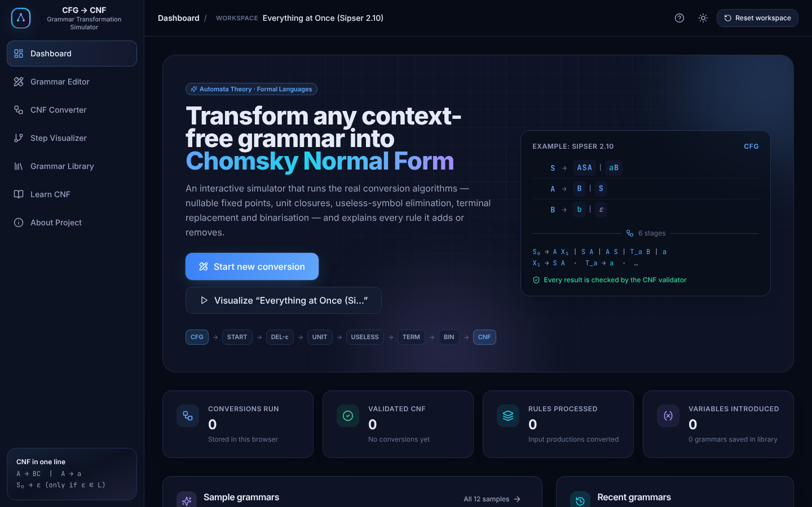
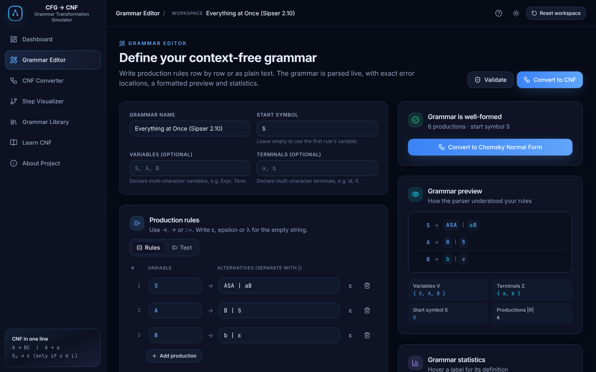
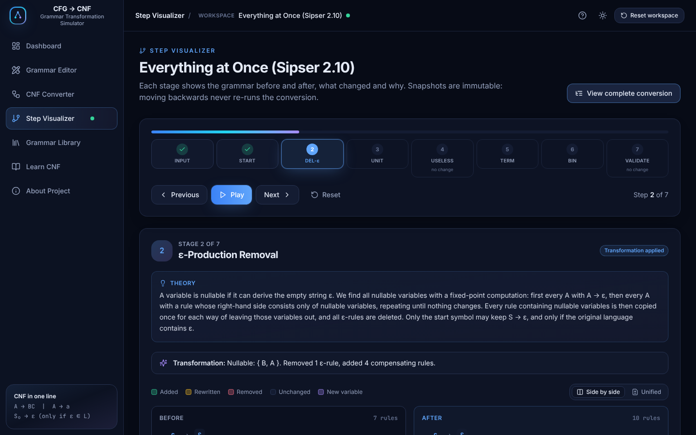
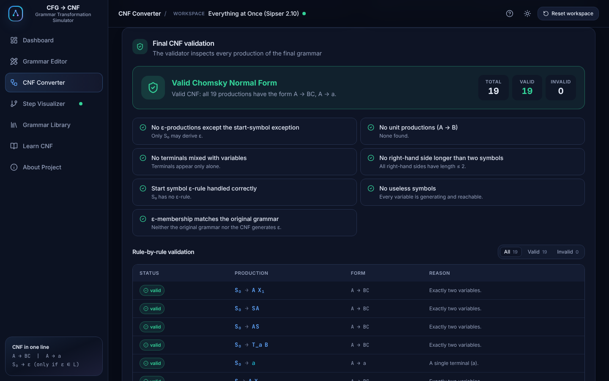
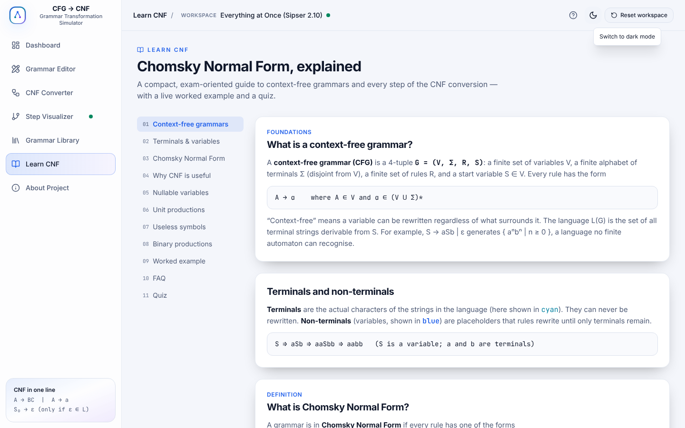
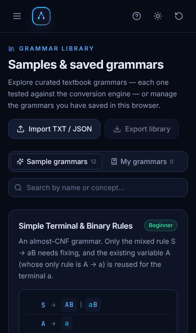

# CFG → CNF Converter — Interactive Grammar Transformation Simulator

An educational web application that converts any **context-free grammar (CFG)** into **Chomsky Normal Form (CNF)**
using the real textbook algorithms, explains every stage in plain language, and verifies the result with an
independent CNF validator. Built as a university project for **Automata Theory & Formal Languages**.

Everything runs in the browser: no backend, no accounts, no external APIs.



---

## Contents

- [Automata theory background](#automata-theory-background)
- [Features](#features)
- [Technology stack](#technology-stack)
- [Installation and running](#installation-and-running)
- [How the conversion works](#how-the-conversion-works)
- [Grammar input syntax](#grammar-input-syntax)
- [Screenshots](#screenshots)
- [Project structure](#project-structure)
- [Testing](#testing)
- [Limitations](#limitations)
- [Future improvements](#future-improvements)

---

## Automata theory background

A context-free grammar is a 4-tuple **G = (V, Σ, R, S)** whose rules have the form `A → α` with `A ∈ V` and
`α ∈ (V ∪ Σ)*`. A grammar is in **Chomsky Normal Form** when every rule has one of the forms

```
A → BC      (B, C variables)
A → a       (a terminal)
S₀ → ε      (only for the start symbol, only if ε ∈ L(G), and only if S₀ never appears on a right-hand side)
```

Every context-free language has a CNF grammar. CNF is required by the **CYK parsing algorithm**, makes derivation
trees binary (a string of length n ≥ 1 needs exactly 2n − 1 derivation steps) and underlies the pumping lemma for
context-free languages.

## Features

**Grammar Editor**
- Structured rule rows (add, edit, remove) **and** a plain-text mode, always kept in sync
- Live parsing with error messages pinned to line numbers, plus warnings (undeclared symbols, duplicates, symbols
  without productions, empty language)
- Optional declarations of start symbol, variables and terminals; formatted preview and the tuple G = (V, Σ, R, S)
- Statistics: variables, terminals, productions, nullable variables, unit productions, useless symbols
- Load samples, save to the library, import TXT/JSON, export TXT/JSON, copy

**CNF Converter**
- Pipeline overview of all stages (applied / skipped, number of changes)
- Original and final grammar with **TXT/JSON download** and copy
- **Validation report**: overall verdict, valid/invalid counts, seven named checks, rule-by-rule table with exact reasons
- Three-way comparison: original · any intermediate stage · final CNF
- Before/after statistics and the list of introduced variables
- **Downloadable conversion report** (TXT and JSON) covering every stage, rule change and validation result
- **CYK membership tester** with the full CYK table, cross-checked against the original grammar
- **Bounded language check** comparing all strings up to a chosen length (clearly labelled as evidence, not proof)

**Step Visualizer**
- Progress tracker; Previous, Next, Play, Pause and Reset controls; keyboard navigation
- For each stage: number, title, theory, transformation summary, the computed sets (nullable rounds, unit closures,
  generating/reachable sets, terminal variables, binary chains), and an ordered step log
- **Side-by-side** and **unified** before/after views with consistent colours: added (green), removed (red),
  rewritten (amber), unchanged (neutral), new variable (violet)
- Every added, removed or rewritten production carries the reason it changed
- "View complete conversion" shows all stages on one page
- Snapshots are immutable, so moving backwards never re-runs the conversion

**Grammar Library**
- 12 sample grammars, each with a description, the concepts it demonstrates and expected properties. All of them
  are **verified against the engine by the test suite**.
- Saved grammars in Local Storage: open, rename, delete, export, per-grammar conversion history
- Import a single grammar, a list of grammars, or an exported library; export the whole library

**Learn CNF**
- Student-friendly theory: CFGs, terminals/variables, CNF, why CNF is useful, nullable variables, unit productions,
  useless symbols, terminal replacement and binarisation
- A complete worked example (Sipser 2.10), **computed live** by the engine
- FAQ and a 13-question **quiz** whose answer key is checked against the engine in tests

**General**
- Dashboard with a project introduction, conversion statistics, recent grammars, sample cards and learning shortcuts
- Dark and light themes, a responsive layout from phone to desktop (with a drawer sidebar on small screens)
- Keyboard shortcuts, tooltips on mathematical terms, visible focus indicators and ARIA labelling
- Robust Local Storage handling: missing or corrupted data falls back to safe defaults

| Shortcut | Action |
| --- | --- |
| `Alt` + `1`…`7` | Jump to a page |
| `Ctrl`/`⌘` + `Enter` | Convert the current grammar |
| `?` | Help and syntax reference |
| `←` / `→`, `Space`, `Home` / `End` | Step Visualizer navigation, play/pause, first/last stage |

## Technology stack

| Layer | Technology |
| --- | --- |
| UI | React 18, Vite 5, JavaScript (ES2022) |
| Styling | Tailwind CSS 3 with CSS-variable design tokens (dark and light) |
| Motion and icons | Framer Motion, Lucide React |
| Fonts | Inter and JetBrains Mono, bundled locally via Fontsource |
| Logic | Pure JavaScript modules, independent of React |
| Storage | Browser Local Storage |
| Tests | Vitest, React Testing Library, jsdom |

## Installation and running

Requirements: **Node.js 18+** (tested with Node 22) and npm.

```bash
git clone https://github.com/YashAgarwal2309/CFG-to-CNF-Converter.git
```

```bash
cd CFG-to-CNF-Converter
```

```bash
npm install
```

Start the development server (then open the printed URL, usually http://localhost:5173):

```bash
npm run dev
```

Create and preview a production build (static files in `dist/`, deployable to any static host):

```bash
npm run build
```

```bash
npm run preview
```

## How the conversion works

```
INPUT CFG
  → 1. START    start symbol augmentation
  → 2. DEL-ε    ε-production removal
  → 3. UNIT     unit production removal
  → 4. USELESS  useless symbol removal
  → 5. TERM     terminal replacement
  → 6. BIN      binary production conversion
  → 7. VALIDATE final CNF validation
OUTPUT CNF
```

| Stage | Algorithm |
| --- | --- |
| 1. Start augmentation | Adds a fresh `S₀ → S` **only** when the start symbol appears on some right-hand side. |
| 2. ε-removal | Computes nullable variables by fixed-point iteration, adds every variant of each rule obtained by omitting any subset of nullable occurrences (no duplicates), deletes ε-rules, and keeps `S₀ → ε` exactly when ε ∈ L(G). |
| 3. Unit removal | Computes the unit closure of every variable with breadth-first search (so cycles such as `A → B → C → A` terminate), copies the non-unit rules of every variable in the closure, then deletes all unit rules. |
| 4. Useless removal | Removes **non-generating** variables first (fixed point), then **unreachable** ones (BFS from S). This order is required for correctness. |
| 5. Terminal replacement | Replaces each terminal in right-hand sides of length ≥ 2 by a shared `T_a → a`, reusing an existing non-start variable whose only rule is `X → a`. Rules `A → a` are untouched. |
| 6. Binary conversion | Splits `A → B₁…Bₙ` (n ≥ 3) into `A → B₁X₁, X₁ → B₂X₂, …`; identical suffixes share one chain variable. |
| 7. Validation | Checks every rule's form, ε-handling, unit rules, mixed terminals, lengths, useless symbols, and that ε ∈ L(CNF) ⇔ ε ∈ L(original). |

Design guarantees:
- Every stage returns a **deeply frozen** snapshot plus the changes it made: rules added, removed and rewritten (each
  with a reason), variables introduced and removed, computed sets and warnings.
- A reconciliation step diffs each snapshot against the previous one, so no production can disappear unexplained.
- Fresh names (`S₀`, `T_a`, `X₁`, …) are checked against every existing symbol and get primes or new indices on collision.
- Invalid input is rejected by the parser with explanations. Pathological inputs (more than 16 nullable occurrences
  in one rule, or more than 20,000 rules) stop with a clear message instead of freezing the browser or producing
  wrong output.

### Example (Sipser, Example 2.10)

```
Input:                          Output (validated CNF):
S → ASA | aB                    S₀ → A X₁ | S A | A S | T_a B | a
A → B | S                       S  → A X₁ | S A | A S | T_a B | a
B → b | ε                       A  → b | A X₁ | S A | A S | T_a B | a
                                B  → b
                                T_a → a
                                X₁ → S A
```

## Grammar input syntax

```
# comments start with # or //
S -> A B | a          arrows: ->  →  ::=
A -> aA | ε           ε, epsilon, λ, lambda or '' denote the empty string
  | b                 a line starting with | continues the previous rule
Expr -> Expr '+' Term multi-character variables are recognised once they appear on a left-hand side
<term> -> 'id'        <name> = variable, 'text' or "text" = terminal
```

Tokenisation rules: uppercase letters are variables and other characters are terminals; spaces are optional. A
name defined on a left-hand side (or declared) is never split into letters, and known names take priority, so
`S -> 0S1` reads as `0 · S · 1`. An undefined identifier such as `X1`, `S₀`, `T_a` or `A'` is read as one variable.

## Screenshots

| | |
| --- | --- |
|  Grammar editor with live preview and statistics |  Step visualizer: ε-removal with highlighted changes |
|  Rule-by-rule CNF validation |  Learn CNF (light theme) |

<p align="center"></p>

## Project structure

```
src/
├── algorithms/                 pure conversion logic (no React)
│   ├── grammar.js              immutable grammar model, diffing, deep freeze
│   ├── grammarParser.js        parser and symbol tokenizer
│   ├── grammarSerializer.js    text / JSON output that re-parses identically
│   ├── grammarAnalysis.js      nullable, generating, reachable, unit closures, statistics
│   ├── augmentStartSymbol.js   stage 1
│   ├── epsilonRemoval.js       stage 2
│   ├── unitRemoval.js          stage 3
│   ├── uselessSymbolRemoval.js stage 4
│   ├── terminalReplacement.js  stage 5
│   ├── binaryConversion.js     stage 6
│   ├── cnfValidator.js         final validation
│   ├── stageResult.js          shared stage result builder + change reconciliation
│   ├── symbols.js, format.js   naming and formatting helpers
├── engine/
│   ├── conversionPipeline.js   runs the stages, produces the immutable history
│   ├── conversionHistory.js    history summaries, TXT/JSON reports
│   └── languageCheck.js        bounded language enumeration, CYK
├── data/                       sample grammars, quiz bank
├── context/                    workspace state, routing, persistence
├── components/
│   ├── layout/                 app shell, sidebar, top bar, help, toasts
│   ├── grammar/                grammar views, stage detail, validation, statistics, CYK
│   └── ui/                     buttons, cards, tabs, modal, tooltip, …
├── pages/                      Dashboard, Editor, Converter, Visualizer, Library, Learn, About
├── utils/                      Local Storage, file import/export, editor row helpers
├── styles/                     Tailwind entry and theme tokens
└── __tests__/                  Vitest suites
```

## Testing

```bash
npm test
```

The suite (about 200 tests) covers:

- **Parser**: every notation, tokenizer rules (multi-character names, quoted terminals, `0S1`, subscripts),
  syntax errors with line numbers, warnings, and serializer round trips for every sample
- **Each algorithm on its own**: fixed points, subset expansion, unit cycles, the order of useless-symbol removal,
  terminal reuse, chain sharing, name collisions and immutability. Every stage's recorded changes must match the
  real diff.
- **Validator**: each invalid form with its reason, the start-symbol ε rules, useless symbols, ε-membership
- **Pipeline**: all 15 required edge cases (empty language, ε-only language, start on the right-hand side, unit
  cycles, collisions with `S₀`/`T_a`/`X₁`, invalid syntax, …) plus the huge-expansion guard
- **Language preservation**: every sample, the edge cases and **270 random grammars** are compared with their CNF
  on all strings up to a length bound; CYK is checked against enumeration
- **Quiz**: answer keys verified by the engine
- **UI** (React Testing Library): navigation, theme, live errors, conversion, stepping, stale detection, library
  CRUD, corrupted storage, import/export

> **Note on language preservation.** Comparing languages up to a length bound is strong evidence, **not** a proof of
> equivalence (CFG equivalence is undecidable in general). Correctness rests on each stage being a standard
> language-preserving construction. The bounded tests guard the implementation against mistakes, and passing
> CNF *syntax* validation is never treated as proof that the language was preserved.

## Limitations

- Bounded language comparison is evidence, not proof (see above).
- A rule with more than 16 nullable occurrences, or a conversion producing more than 20,000 rules, is rejected.
- CYK testing accepts strings of up to 30 symbols; its cross-check against the original grammar runs up to length 8.
- Saved grammars live in one browser's Local Storage. Export them to back them up or move them.
- The resulting CNF is one valid normal form. Other orders or naming schemes yield different but equivalent grammars.

## Future improvements

- Derivation and parse-tree visualisation for strings accepted by CYK
- Greibach Normal Form as a second target
- Optional alternative stage orders (e.g. Hopcroft–Ullman: useless symbols first) for comparison
- Shareable links that encode a grammar in the URL
- PDF export of the conversion report
